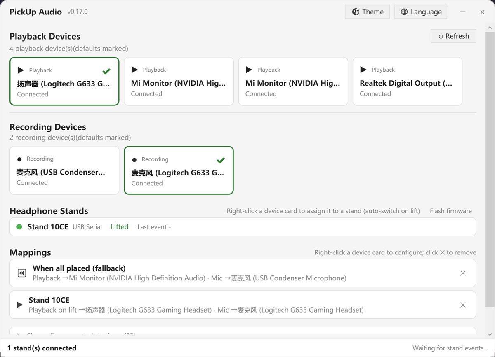
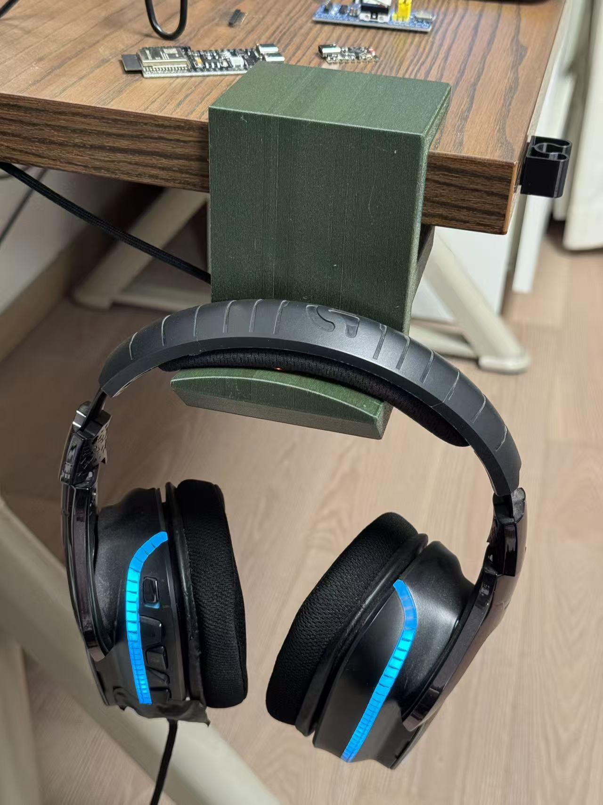
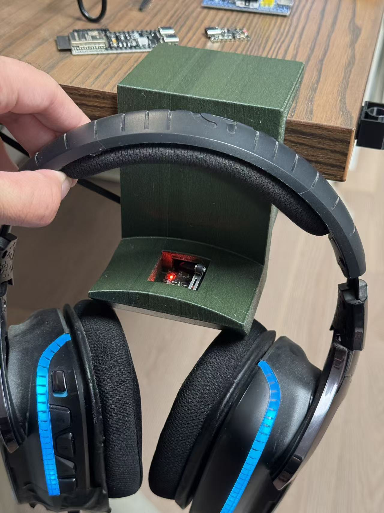
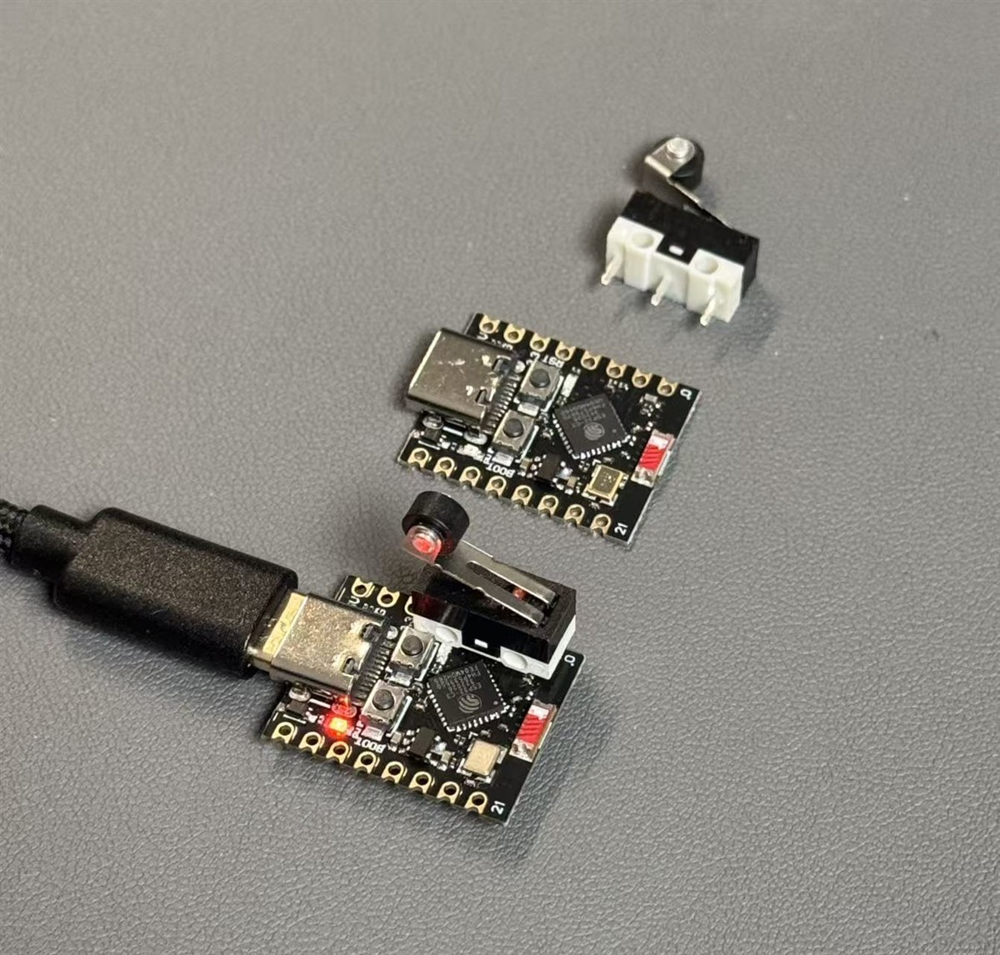

# PickUp Audio · 架上知音

**[English](README.md)** | **[简体中文](README.zh-CN.md)**

**A smart headphone stand that switches your Windows audio devices when you pick up or put down your headphones.**

Place your headphones on the stand — audio goes to your speakers. Pick them up — audio switches to your headphones. No hotkeys, no menus, no thinking.
**Supports multiple stands simultaneously** — each binds to a different headset; last-lifted wins. A sensor on the stand reports pick-up / place events over USB (8-byte protocol frames with ACK / retransmit / de-duplication), and a lightweight Windows tray app does the switching. Fully offline, no accounts, no telemetry.

**Recommended hardware:**

| Path | Barrier | Transport |
|---|---|---|
| **ESP32-C3** (v2, recommended) | No flasher hardware, one-click flash in the app (switch pins go straight into the board's pin holes, 2 solder joints) | USB serial |

## Project status

| Part | Status |
|---|---|
| Host app (Windows tray) | ✅ **done** — dual-transport architecture (HID + serial); the HID link was verified on real hardware incl. a 115-press stress test, the serial link incl. an automated bench suite (11/11 on real hardware) |
| Firmware `firmware-c3/` (ESP32-C3, recommended) | ✅ **done** — verified on real hardware: buttonless one-click flashing, full event/ACK/retransmit chain, and a second brand-new board taken from plug-in to recognized stand end-to-end |
| Hardware (enclosure / PCB) | 🚧 **work-in-progress, contributions wanted**: the current device is a working prototype — the electronics sit on a bare ESP32-C3 SuperMini inside a custom 3D-printed stand (with a compartment for the board and a cable pass-through). A custom PCB and a proper enclosure (STL/STEP) are the most wanted contributions, see [CONTRIBUTING.md](CONTRIBUTING.md) |

> Current release: **v0.17.0** (see [CHANGELOG](AudioCtrl/docs/CHANGELOG.md)). Known gap: no code-signed
> builds (SmartScreen will warn on first run — "More info → Run anyway").
> Handing this repo to an AI coding agent? Have it read [AGENTS.md](AGENTS.md) first.

> The UI ships in Chinese and English (follows the system language by default). Code comments are in Chinese — see [README.zh-CN.md](README.zh-CN.md).

## Screenshots



## How it works

```
            headphones on/off
                  │
          ┌───────▼───────┐
          │  Headphone    │  ESP32-C3 SuperMini (recommended) · micro switch, 30ms debounce
          │  stand        │  watchdog, retry w/ ACK
          └───────┬───────┘
                  │ USB serial (8-byte frames + CRC8)
          ┌───────┴───────┐
          │ USB CDC      │  driver-free on Win10/11
          └───────┬───────┘
          ┌───────▼───────┐
          │  AudioCtrl    │  Windows tray app, .NET 10 WPF
          │  host app     │  dual-transport hub + multi-stand scheduler
          └───────┬───────┘
                  │ switches default device via
                  ▼ Core Audio (PolicyConfig COM)
        speakers ⇄ headphones ⇄ anything you bind
```

- Each stand is identified by a hash of the chip's unique ID (eFuse MAC), so multiple stands are supported and remembered independently.
- Events are sequenced and ACKed (firmware retransmits 4× at 300 ms). Duplicate frames are de-duplicated on the host.
- Bind devices by right-clicking a device card: "when headphones are lifted use this device", per stand. When all headphones are back on their stands, the app falls back to your speakers.
- Pick up two headphones? The most recently lifted one wins.

## Features

- Card view of all playback/recording devices; one click to set the default device
- **Multi-stand support**: connect N stands, each independently bound to a different headset; last-lifted wins, all-placed falls back to speakers
- Automatic stand discovery (plug & play, hot-plug reconnect, resume-after-sleep re-sync)
- **One-click C3 firmware flashing inside the app** — plug in a fresh board, hit "Flash", ~2 s, no buttons, no ST-Link
- Right-click a stand card for "**simulate lift/place**" — try everything before wiring a switch
- Per-stand device bindings stored by device ID (identical device names don't conflict)
- Optional auto-pairing of a headset's microphone
- System tray with quick switching, auto-start toggle, light/dark theme
- UI language switch: system / 中文 / English (title: 架上知音 / PickUp Audio)
- Rolling file logs (`Logs/`, 7 days retained) next to the exe — portable, zero-install
- Switch notifications: playback + recording merged into one toast; a tray toggle silences them all
- Right-click a stand card: delete a stand (incl. its mappings); serial stands offer a simulate lift/place command

## Hardware

### ESP32-C3 SuperMini (recommended route)

**Buy two things (¥10-15 ≈ $2 total), solder 2 joints (switch pins into board holes), plug in USB, click one button. Done.**

| Part | Notes |
|---|---|
| ESP32-C3 SuperMini | Search "ESP32-C3 SuperMini" on Taobao, ~¥7-10, the highest-volume minimal board. **Make sure it's a C3** (not S3/C6/S2), and **native USB** — only the main chip next to the USB-C connector (boards with a CH340/CP2102 bridge chip won't work) |
| KW12 roller-lever micro switch | Search "KW12 micro switch roller", ~¥1-3; 3 pins (COM/NO/NC), 5.08mm pitch = every other hole on the board's 2.54mm header |

Wiring (switch's COM and NO pins go into board header holes with one hole skipped between them, solder 2 joints; leave NC unconnected):

| Switch | Connects to |
|---|---|
| COM | GPIO0 (input, internal pull-up) |
| NO (normally open) | GPIO2 (driven low by the firmware as the "ground" side; a real GND pin works too) |

Headphones resting on the stand press the roller (contact, low level) = placed; lifting them releases it (high level) = lifted. A fallen-off wire reads as "lifted" (fail direction: audio goes to the headphones — it never leaks out of the speakers).

**Pitfall checklist**:

- The USB cable must be a **data cable** — 2-wire charge-only cables won't even enumerate
- Wire only GPIO0/GPIO2 (or GND) as shown above; never GPIO8/9 (strapping pins). GPIO2 is also a strapping pin, but it is safe in this exact wiring (it defaults to an internal pull-up at reset while GPIO0 is high-impedance — a cold reboot with the switch pressed cannot enter download mode)
- Clone SuperMinis exist with mirrored/rearranged silkscreen — **confirm the pins are really labeled "0" and "2" before plugging**
- Firmware: install the host app → plug in the board → "**Flash firmware**" in the UI → pick the port → start, ~2 s, buttonless (see [FLASHING.md](AudioCtrl/docs/FLASHING.md))
- **Dual trigger sources**: the on-board BOOT button and the micro switch are equivalent sensors — **whichever key last changed (press/release) takes over as the trigger** (no switch soldered? just use BOOT; touch the switch later and it takes over). The stand card's right-click menu simulates lift/place too

**The stand** (3D-printed + ESP32-C3 + micro switch, clamps to desk edge):

| Headphones placed → speakers | Headphones lifted → headset |
|---|---|
|  |  |

**C3 hardware photos** (top: bare board + spare switch; bottom: assembled, powered on):



3D model downloads: [`hardware/`](hardware/)

> **Future goal: fully solder-free** — the board's BOOT button already works as an
> equivalent trigger (firmware dual-trigger source). A mechanical design where the
> headphone's weight presses the BOOT button directly would eliminate the external
> switch and soldering entirely — the most valuable enclosure contribution, see
> [CONTRIBUTING.md](CONTRIBUTING.md).
>
> **Design constraint:** GPIO9 is the BOOT strapping pin — holding it low at
> power-up enters the ROM downloader. A no-solder enclosure must keep BOOT released
> while USB power is applied, or use a non-strapping pin.

**Enclosure / PCB status:** the current stand is a custom 3D-printed part with a compartment for the board — functional, awaiting a polished redesign. Custom enclosure design (STL/STEP) and a proper
PCB are explicitly **welcome contributions**.

Firmware source: [`firmware-c3/`](firmware-c3/) (PlatformIO project).
3D-printable stand models: [`hardware/`](hardware/) (STL files + photos + assembly guide).
Protocol details: [docs/PROTOCOL.md](AudioCtrl/docs/PROTOCOL.md)

## Download & quick start

Download the portable zip from **Releases** (self-contained .NET 10, no
installer), then:

1. **Unzip to any folder** (e.g. `D:\AudioCtrl`) and double-click `AudioCtrl.exe`.
   - First run: Windows SmartScreen will warn on the unsigned exe — click
     "More info → Run anyway".
2. **Plug in the stand** — boards with firmware are detected within a second;
   a **brand-new C3 board** is flashed via the in-app "Flash firmware" button
   and then recognized automatically.
3. **Bind your devices**: right-click a device card → "use this device when
   headphones are lifted" (pick the stand) / "use this device when placed".
   Lift & place once to see it switch (no switch wired yet? Right-click the
   stand card → "Simulate lift/place").
4. **Start with Windows is ON by default** — the app registers itself on first
   launch (toggle anytime in the tray icon's right-click menu). It starts
   silently to the tray, no window pops up at boot.

No install, no admin rights, fully offline. Uninstall = exit from the tray and
delete the folder. (If the exe folder is read-only, e.g. unpacked into Program
Files, config/logs fall back to `%LOCALAPPDATA%\AudioCtrl\` — delete that folder
too for a complete removal.)

Building from source takes one command — see below.

## Build

**Host app** (needs [.NET 10 SDK](https://dotnet.microsoft.com/download)):

```bash
cd AudioCtrl
dotnet run                                                        # dev run
dotnet publish -c Release -r win-x64 --self-contained -p:PublishSingleFile=true
# → zip the publish/ folder: a portable app, no installer, no runtime needed
```

**Firmware · C3 tier** (needs [PlatformIO](https://platformio.org/) — VSCode extension or CLI):

```bash
pio run -d firmware-c3                                # build only
pio run -d firmware-c3 -t upload --upload-port COMx   # build + flash (buttonless)
```

## Project layout

| Path | Description |
|---|---|
| `AudioCtrl/` | Windows host app (C# / .NET 10 / WPF, zero NuGet dependencies, dual transport) |
| `AudioCtrl/docs/` | Protocol spec, architecture notes, flashing guide, changelog |
| `firmware-c3/` | ESP32-C3 firmware (PlatformIO + Arduino, incl. bench-test scripts) |
| `stm32/` | Legacy STM32 hardware archive (source + docs, no longer updated) |

> **Legacy STM32 hardware**: the v1 STM32F103 route (2 solder joints + ST-Link) is
> archived in [stm32/](stm32/). The host app still supports it.

## License & acknowledgments

Original code: [MIT](LICENSE). Bundled third-party components: [THIRD-PARTY-NOTICES.md](THIRD-PARTY-NOTICES.md).

Thanks to [SoundSwitch](https://github.com/Belphemur/SoundSwitch) and EreTIk's
policyconfig research for the `IPolicyConfig` ABI knowledge used for default-device
switching.
