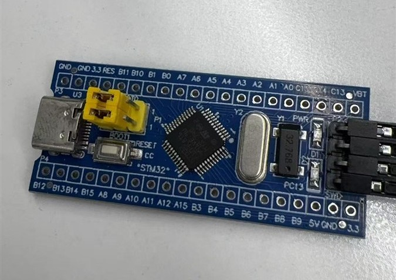
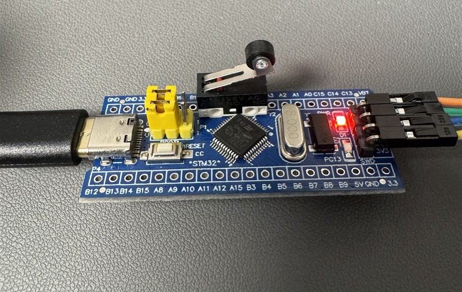
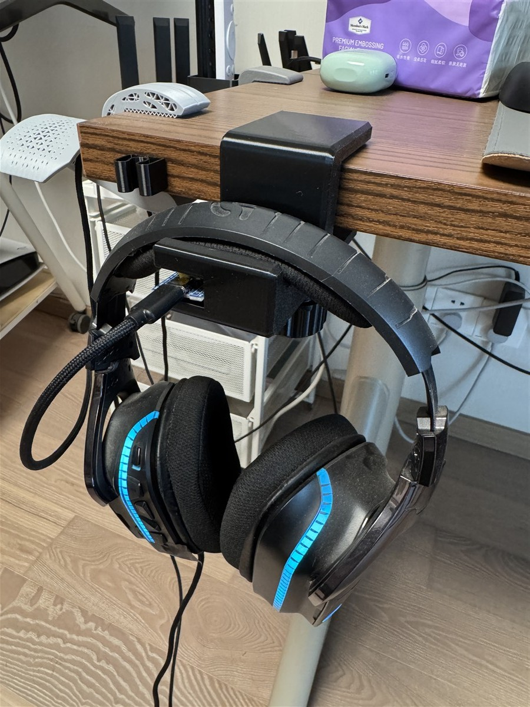
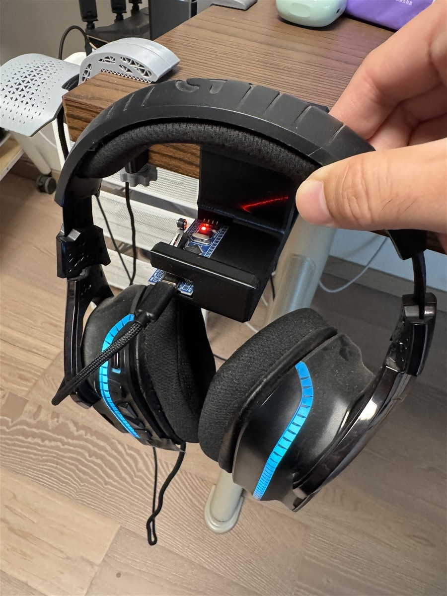

# AutoAudioCtrl · Auto Audio Control

**[English](README.md)** | **[简体中文](README.zh-CN.md)**

**A smart headphone stand that switches your Windows audio devices when you pick up or put down your headphones.**

Place your headphones on the stand — audio goes to your speakers. Pick them up — audio switches to your headphones. No hotkeys, no menus, no thinking. An STM32-powered stand reports sensor events over USB HID, and a lightweight Windows tray app does the switching. Fully offline, no accounts, no telemetry.

## Project status

| Part | Status |
|---|---|
| Host app (Windows tray) | ✅ **done**, verified end-to-end on real hardware (incl. a 115-press stress test) |
| Firmware (STM32F103C8T6) | ✅ **done**, flashed and verified |
| Hardware (enclosure / PCB) | 🚧 **work-in-progress, contributions wanted**: the current device is a working hand-built rig — a commodity dev board with a soldered micro switch inside a hand-modified 3D-printed stand. A custom PCB and a proper enclosure (STL/STEP) are the most wanted contributions, see [CONTRIBUTING.md](CONTRIBUTING.md) |

> Handing this repo to an AI coding agent? Have it read [AGENTS.md](AGENTS.md) first.

> The UI ships in Chinese and English (follows the system language by default). Code comments are in Chinese — see [README.zh-CN.md](README.zh-CN.md).

## How it works

```
            headphones on/off
                  │
          ┌───────▼───────┐
          │  Headphone    │  STM32F103C8T6 "Blue Pill"
          │  stand        │  micro-switch sensor, debounce 30ms
          └───────┬───────┘  watchdog (IWDG), retry w/ ACK
                  │ USB HID, 8-byte frames (protocol v2)
          ┌───────▼───────┐
          │  AudioCtrl    │  Windows tray app, .NET 10 WPF
          │  host app     │  multi-stand scheduler
          └───────┬───────┘
                  │ switches default device via
                  ▼ Core Audio (PolicyConfig COM)
        speakers ⇄ headphones ⇄ anything you bind
```

- Each stand is identified by a hash of the MCU's unique ID, so multiple stands are supported and remembered independently.
- Events are sequenced and ACKed (firmware retransmits 4× at 300 ms). Duplicate frames are de-duplicated on the host.
- Bind devices by right-clicking a device card: “when headphones are lifted use this device”, per stand. When all headphones are back on their stands, the app falls back to your speakers.
- Pick up two headphones? The most recently lifted one wins.

## Features

- Card view of all playback/recording devices; one click to set the default device
- Automatic stand discovery (plug & play, hot-plug reconnect, resume-after-sleep re-sync)
- Per-stand device bindings stored by device ID (identical device names don't conflict)
- Optional auto-pairing of a headset's microphone
- System tray with quick switching, auto-start toggle, light/dark theme
- UI language switch: system / 中文 / English (title: 自动音频控制 / Auto Audio Control)
- Rolling file logs (`Logs/`, 7 days retained) next to the exe — portable, zero-install
- Toast notification on every switch

## Hardware (firmware side)

**No custom PCB is needed.** The reference hardware is a commodity STM32
"Blue Pill" minimal-system board with a micro switch soldered directly onto it,
housed in a 3D-printed hook-style stand (the enclosure model is not included
in this repo — its bay was hand-hollowed from a stand model found online). Anyone can reproduce it: buy a Blue Pill
+ a micro switch, solder two wires, flash, done. Three steps, real photos:

**Step 1 · get this board** (any STM32F103C8T6 minimal-system board, Type-C or Micro-USB):



**Step 2 · solder the micro switch onto it** (switch terminals to PB0 and PA6 — that's
the entire soldering work):



**Step 3 · put it in a stand** (this is the real current device — a hand-modified
3D-printed stand; functional but rough, better enclosure designs are welcome):

| Placed (switch pressed → speakers) | Lifted (switch released → headset) |
|---|---|
|  |  |

| Part | Notes |
|---|---|
| STM32F103C8T6 board | any "Blue Pill" minimal-system board; custom bidirectional HID (8B in / 8B out) |
| Micro switch | mouse-button style |
| USB | ST default VID `0483` / PID `572B` — fine for personal use; commercial products need their own VID |

Wiring — just 2 wires:

| Board pin | Connects to |
|---|---|
| `PB0` | one terminal of the micro switch (input, internal pull-up) |
| `PA6` | the other terminal (driven low — acts as the switch's GND) |

Headphones resting on the stand press the switch (PB0 reads **low** = placed);
lifting them releases it (PB0 reads **high** = lifted).

**Enclosure / PCB status:** the current enclosure is a hand-modified 3D-printed
stand — functional, not pretty. Custom enclosure design (STL/STEP) and a proper
PCB are explicitly **welcome contributions**.

Firmware source lives in [`firmware/`](firmware/) (STM32CubeIDE project; custom
code is inside `USER CODE` blocks).
Protocol details: [docs/PROTOCOL.md](AudioCtrl/docs/PROTOCOL.md)

**Need to flash the firmware yourself?** Read
[docs/FLASHING.md](AudioCtrl/docs/FLASHING.md) — what ST-Link to buy, which 4
wires go where, and the one command that flashes it (or just hand that file to
any AI assistant and let it walk you through).

## Download & quick start

Download the portable zip from **Releases** (~56 MB, self-contained .NET 10, no
installer), then:

1. **Unzip to any folder** (e.g. `D:\AudioCtrl`) and double-click `AudioCtrl.exe`.
   - First run: Windows SmartScreen will warn on the unsigned exe — click
     "More info → Run anyway".
2. **Plug in the stand** — it is detected automatically within a second.
3. **Bind your devices**: right-click a device card → "use this device when
   headphones are lifted" (pick the stand) / "use this device when placed".
   Lift & place once to see it switch.
4. **Start with Windows is ON by default** — the app registers itself on first
   launch (toggle anytime in the tray icon's right-click menu). It starts
   silently to the tray, no window pops up at boot.

No install, no admin rights, fully offline. Uninstall = exit from the tray and
delete the folder. (If the exe folder is read-only, e.g. unpacked into Program
Files, config/logs fall back to `%LOCALAPPDATA%\AudioCtrl\` — delete that folder
too for a complete removal.)

Building from source takes one command — see below.

## Build

**Host app** (needs [.NET 10 SDK](https://dotnet.microsoft.com/download)):

```bash
cd AudioCtrl
dotnet run                                                        # dev run
dotnet publish -c Release -r win-x64 --self-contained -p:PublishSingleFile=true
# → zip the publish/ folder: a portable ~56 MB app, no installer, no runtime needed
```

**Firmware** (needs STM32CubeIDE, or use the headless build):

```bash
stm32cubeidec.exe --launcher.suppressErrors -nosplash \
  -application org.eclipse.cdt.managedbuilder.core.headlessbuild \
  -data <workspace-dir> -import <abs-path-to-firmware> -cleanBuild firmware
```

Flash via ST-Link (`STM32_Programmer_CLI -c port=SWD -w firmware.elf -v -rst`).

## Project layout

| Path | Description |
|---|---|
| `AudioCtrl/` | Windows host app (C# / .NET 10 / WPF, zero NuGet dependencies) |
| `AudioCtrl/docs/` | Protocol spec & architecture notes |
| `firmware/` | STM32 firmware (CubeIDE + CubeMX generated + user code) |

## Status

v0.16.1 — core loop verified end-to-end on real hardware (Win10 22H2 and Win11). Chinese/English UI landed. Known gaps: code-signed builds (SmartScreen will warn on first run — "More info → Run anyway"), multi-stand field testing with ≥2 devices. See [CHANGELOG](AudioCtrl/docs/CHANGELOG.md).

## License & acknowledgments

Original code: [MIT](LICENSE). Bundled ST libraries: [THIRD-PARTY-NOTICES.md](THIRD-PARTY-NOTICES.md).

Thanks to [SoundSwitch](https://github.com/Belphemur/SoundSwitch) and EreTIk's
policyconfig research for the `IPolicyConfig` ABI knowledge used for default-device
switching.
