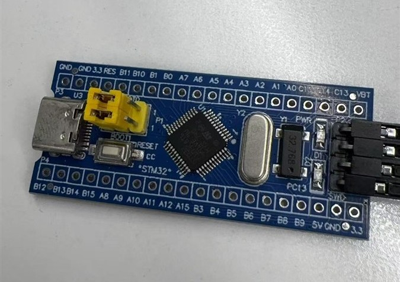
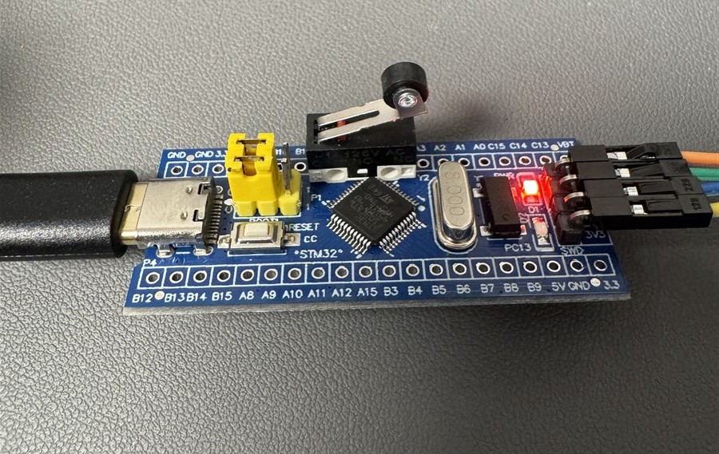
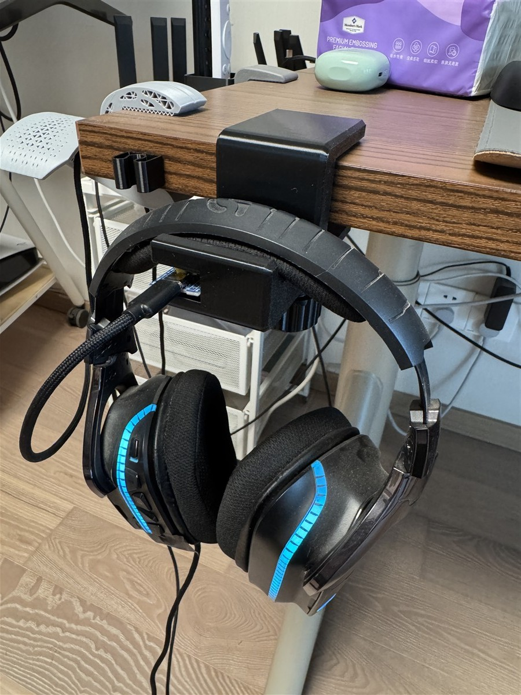
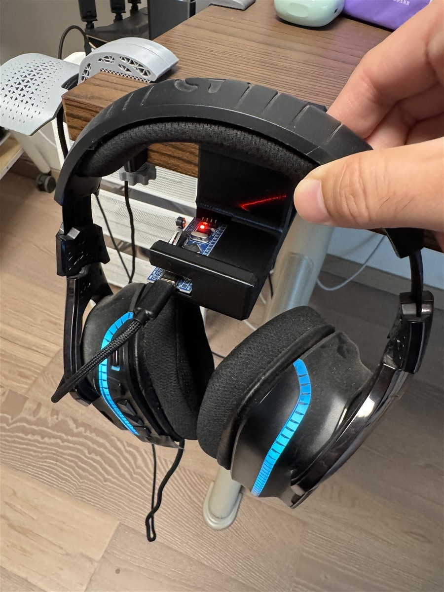

# AutoAudioCtrl · 自动音频控制

**[English](README.md)** | **[简体中文](README.zh-CN.md)**

**拿起耳机自动切耳机、放回支架自动切外放的智能耳机支架。**

耳机放上支架 → 声音切到扬声器；拿起耳机 → 声音切回耳机。无快捷键、无菜单、无感切换。STM32 支架通过传感器检测耳机拿起/放回，经 USB HID（8 字节帧，协议 v2）上报 Windows 上位机，由托盘常驻程序完成默认设备切换。纯本地运行，无联网，无数据上传。

## 项目状态

| 部分 | 状态 |
|---|---|
| 上位机（Windows 托盘程序） | ✅ **完成**，真机端到端验证通过（含 115 次按键压测） |
| 固件（STM32F103C8T6） | ✅ **完成**，烧录验证通过 |
| 硬件（外壳 / PCB） | 🚧 **待完善，欢迎贡献**：目前是能用的手工装置——市售最小系统板 + 微动开关直焊，装进手工掏空的 3D 打印支架。定制 PCB 与正式外壳设计（STL/STEP）是最需要的社区贡献，见 [CONTRIBUTING.md](CONTRIBUTING.md) |

> 要把仓库交给 AI 助手开发？让它先读 [AGENTS.md](AGENTS.md)。

## 工作原理

```
            耳机拿起 / 放回
                  │
          ┌───────▼───────┐
          │  耳机支架     │  STM32F103C8T6（Blue Pill）
          │               │  微动开关传感器，30ms 消抖
          └───────┬───────┘  IWDG 看门狗，事件 ACK + 重传
                  │ USB HID，8 字节帧（协议 v2）
          ┌───────▼───────┐
          │  AudioCtrl    │  Windows 托盘程序，.NET 10 WPF
          │  上位机       │  多支架调度器
          └───────┬───────┘
                  │ 经 Core Audio（PolicyConfig COM）切换
                  ▼
        扬声器 ⇄ 耳机 ⇄ 任何你绑定的设备
```

- 每个支架用 MCU 唯一 ID 的哈希标识，支持多支架独立记忆映射
- 事件带序号 + ACK 确认（固件 300ms×4 重传），上位机按 seq 去重
- 右键设备卡片绑定："耳机拿起时使用此设备"，按支架分别配置
- 全部放回 → 切回配置的外放设备；同时拿起多副 → 后拿起的优先

## 功能

- 播放/录音设备卡片视图，点击即设为默认
- 支架即插即用：热插拔自动重连、睡眠唤醒后自动对齐状态
- 映射按设备 ID 存储（同名设备不冲突），可选自动配对耳机麦克风
- 系统托盘：快速切换设备子菜单、开机自启开关、深浅主题跟随
- 界面语言切换：跟随系统 / 中文 / English（产品名：自动音频控制 / Auto Audio Control）
- exe 同级滚动文件日志（保留 7 天），便携免安装
- 每次切换右下角 Toast 提示

## 硬件

**不需要自制 PCB。** 参考硬件就是一块网上直接买得到的 STM32"Blue Pill"最小系统板，
微动开关直接焊在板上（两根线），装进 3D 打印的挂钩式支架里（外壳模型未收录在本仓库——
仓位是从网上找的支架模型手工掏出来的）。任何人想复现：买块最小系统板 + 一个微动开关，
焊两根线、烧录固件即可。复现三步，实拍图如下：

**第 1 步 · 买这块板**（任意 STM32F103C8T6 最小系统板，Type-C 或 Micro-USB 口均可）：



**第 2 步 · 把微动开关焊上去**（开关两脚分别接 PB0 与 PA6，这就是全部焊接量）：



**第 3 步 · 装进支架**（下图即当前真实装置——手工掏空的 3D 打印支架，能用但粗糙，
更好的外壳设计欢迎贡献）：

| 耳机放下（压住开关 → 声音走外放） | 耳机拿起（开关弹起 → 声音切耳机） |
|---|---|
|  |  |

| 部件 | 说明 |
|---|---|
| STM32F103C8T6 核心板 | 任意"Blue Pill"最小系统板；自定义双向 HID（8 字节收/发） |
| 微动开关 | 鼠标键式微动 |
| USB | ST 默认 VID `0483` / PID `572B`（个人使用没问题，量产需申请自有 VID） |

接线（共 2 根线）：

| 引脚 | 接到 |
|---|---|
| `PB0` | 微动开关一端（输入，内部上拉） |
| `PA6` | 微动开关另一端（输出低电平，相当于开关的 GND） |

耳机放在架上压住开关（PB0 读到**低电平** = 在架上）；拿起耳机开关弹起（**高电平** = 已拿起）。

**外壳 / PCB 现状：** 目前的外壳是手工改造的 3D 打印支架——能用，但不好看。
自定义外壳设计（STL/STEP）和正式 PCB 都是**欢迎社区贡献**的部分。

固件源码在 [`firmware/`](firmware/)（STM32CubeIDE 工程，自定义代码全部在 `USER CODE` 区内）。
协议细节：[PROTOCOL.md](AudioCtrl/docs/PROTOCOL.md)

**需要自己烧录固件？** 看 [FLASHING.md](AudioCtrl/docs/FLASHING.md)——买什么 ST-Link、
4 根线接哪、一条命令烧录，全在里面（不懂烧录的话，把那个文件丢给任意 AI 助手让它带你做）。

## 下载与使用

从 **Releases** 页面下载便携版 zip（约 56MB，自带 .NET 10 运行时，免安装），然后：

1. **解压到任意文件夹**（如 `D:\AudioCtrl`），双击 `AudioCtrl.exe` 即用。
   - 首次运行 Windows SmartScreen 会对未签名 exe 弹提示：点"**更多信息 → 仍要运行**"。
2. **插上耳机支架**——1 秒内自动识别，界面出现支架状态。
3. **绑定设备**：右键设备卡片 →"耳机拿起时使用此设备（选支架）"/"耳机放下时使用此设备"。
   拿起、放回一次即可看到自动切换。
4. **开机自启默认已开启**——程序首次运行会自动注册（托盘右键菜单里可随时开关）。
   开机时静默驻留托盘，不会弹窗口。

无需安装、无需管理员权限、完全离线。卸载 = 托盘退出 + 删除文件夹。
（若 exe 目录只读——比如解压进了 Program Files——配置/日志会自动落到
`%LOCALAPPDATA%\AudioCtrl\`，彻底卸载时把该目录一并删除。）

从源码编译只需一条命令（见下）。

## 编译

**上位机**（需 [.NET 10 SDK](https://dotnet.microsoft.com/download)）：

```bash
cd AudioCtrl
dotnet run                                                        # 开发运行
dotnet publish -c Release -r win-x64 --self-contained -p:PublishSingleFile=true
# 打包 publish/ 目录为 zip：约 56MB 绿色免安装版
```

**固件**（需 STM32CubeIDE，或 headless 编译）：

```bash
stm32cubeidec.exe --launcher.suppressErrors -nosplash \
  -application org.eclipse.cdt.managedbuilder.core.headlessbuild \
  -data <workspace目录> -import <firmware绝对路径> -cleanBuild firmware
```

## 状态

v0.16.1 —— 核心闭环已在真实硬件上端到端验证（Win10 22H2 与 Win11 双平台，含 115 次按键压测），中英文界面已就绪。已知待办：代码签名（未签名首次运行会弹 SmartScreen，点"更多信息→仍要运行"即可）、≥2 台支架实测。更新记录见 [CHANGELOG](AudioCtrl/docs/CHANGELOG.md)。

## 许可与致谢

原创代码：[MIT](LICENSE)。内置 ST 库：[THIRD-PARTY-NOTICES.md](THIRD-PARTY-NOTICES.md)。

感谢 [SoundSwitch](https://github.com/Belphemur/SoundSwitch) 与 EreTIk 的 policyconfig
研究——切换默认设备所用的 `IPolicyConfig` ABI 知识来自这些公开资料。
