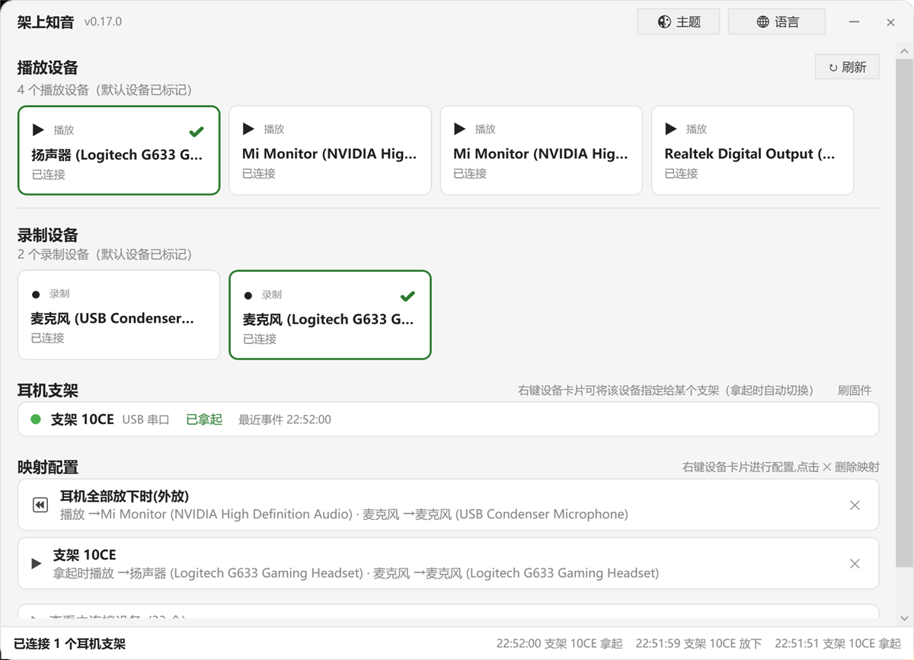
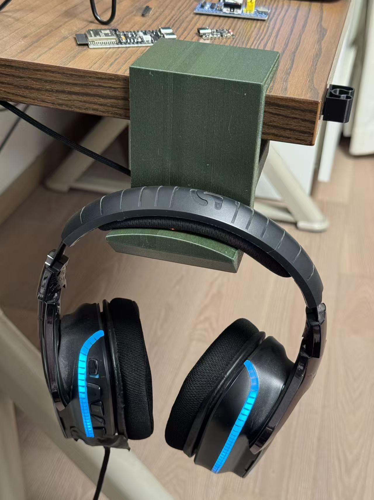
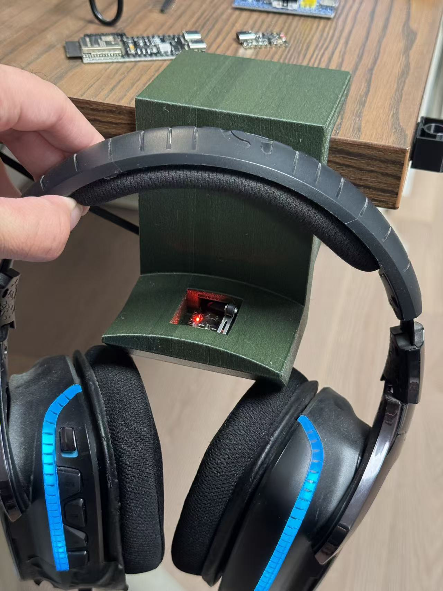
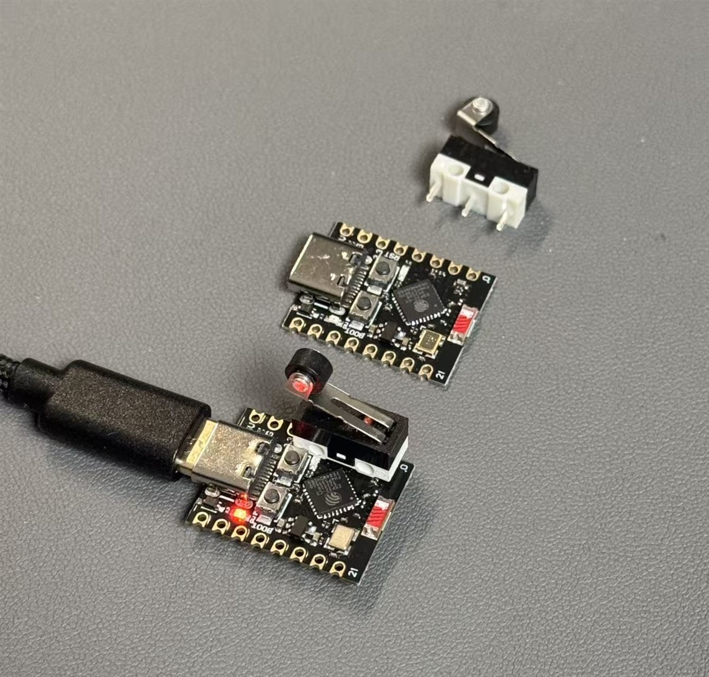

# 架上知音 · PickUp Audio

**[English](README.md)** | **[简体中文](README.zh-CN.md)**

**拿起耳机自动切耳机、放回支架自动切外放的智能耳机支架。**

耳机放上支架 → 声音切到扬声器；拿起耳机 → 声音切回耳机。无快捷键、无菜单、无感切换。
**支持同时接入多个耳机支架**——每个支架独立绑定不同耳机，后拿起的优先。
支架上的传感器检测耳机拿起/放回，经 USB 上报 Windows 上位机（8 字节协议帧，带 ACK/重传/去重），
由托盘常驻程序完成默认设备切换。纯本地运行，无联网，无数据上传。

| 硬件 | 门槛 | 通信 |
|---|---|---|
| **ESP32-C3 SuperMini**（推荐） | 免烧录器，app 内一键烧录（开关引脚直插排针孔焊 2 个点） | USB 串口 |

## 项目状态

| 部分 | 状态 |
|---|---|
| 上位机（Windows 托盘程序） | ✅ **完成**，双传输架构（HID + 串口）；HID 链路真机验证含 115 次按键压测，串口链路含自动化台架测试（真机 11/11 项） |
| 固件 `firmware-c3/`（ESP32-C3，推荐档） | ✅ **完成**，真机验证：免按键一键烧录、事件/ACK/重传全链路、第二块新板从插上到识别全程实测 |
| 硬件（外壳 / PCB） | 🚧 **待完善，欢迎贡献**：目前是能用的原型装置——电子部分直插直焊在一块 ESP32-C3 SuperMini 上，装进 3D 打印定制支架（预留电路板仓和走线孔）。定制 PCB 与正式外壳设计（STL/STEP）是最需要的社区贡献，见 [CONTRIBUTING.md](CONTRIBUTING.md) |

> 当前版本 **v0.17.0**（更新记录见 [CHANGELOG](AudioCtrl/docs/CHANGELOG.md)）。已知待办：代码签名（首次运行 SmartScreen 提示点"仍要运行"即可）。
> 要把仓库交给 AI 助手开发？让它先读 [AGENTS.md](AGENTS.md)。

## 界面截图



## 工作原理

```
            耳机拿起 / 放回
                  │
          ┌───────▼───────┐
          │  耳机支架     │  ESP32-C3 SuperMini（推荐档）· 微动开关，30ms 消抖
          │               │  看门狗，事件 ACK + 重传
          └───────┬───────┘
                  │ USB 串口（8 字节帧 + CRC8）
          ┌───────┴───────┐
          │ USB CDC      │  Win10/11 免驱
          └───────┬───────┘
          ┌───────▼───────┐
          │  AudioCtrl    │  Windows 托盘程序，.NET 10 WPF
          │  上位机       │  双传输聚合 + 多支架调度器
          └───────┬───────┘
                  │ 经 Core Audio（PolicyConfig COM）切换
                  ▼
        扬声器 ⇄ 耳机 ⇄ 任何你绑定的设备
```

- 每个支架用芯片唯一 ID 的哈希标识（eFuse MAC），支持多支架独立记忆映射
- 事件带序号 + ACK 确认（固件 300ms×4 重传），上位机按 seq 去重
- 右键设备卡片绑定："耳机拿起时使用此设备"，按支架分别配置
- 全部放回 → 切回配置的外放设备；同时拿起多副 → 后拿起的优先

## 功能

- 播放/录音设备卡片视图，点击即设为默认
- **多支架支持**：同时接入 N 个支架，每个独立绑定不同耳机；后拿起的优先，全部放回切外放
- 支架即插即用：热插拔自动重连、睡眠唤醒后自动对齐状态
- **app 内一键烧录 C3 固件**：新板插上 → 点"刷固件"→ 2 秒完成，全程免按键、免 ST-Link
- 支架卡片右键"**模拟拿起/放回**"——不接微动开关也能完整体验
- 映射按设备 ID 存储（同名设备不冲突），可选自动配对耳机麦克风
- 系统托盘：快速切换设备子菜单、开机自启开关、深浅主题跟随
- 界面语言切换：跟随系统 / 中文 / English（产品名：架上知音 / PickUp Audio）
- exe 同级滚动文件日志（保留 7 天），便携免安装
- 切换通知 Toast（播放+录制合并为一条；托盘可一键关闭全部通知）
- 支架卡片右键：删除支架（含映射）、串口支架可模拟拿起/放回

## 硬件

### ESP32-C3 SuperMini（推荐路线）

**买两样东西（合计 ¥10-15），开关引脚插进板上的孔焊 2 个点，插上 USB，点一下按钮，完成。**

| 部件 | 说明 |
|---|---|
| ESP32-C3 SuperMini | 淘宝搜 "ESP32-C3 SuperMini"，约 ¥7-10，销量最大的最小系统板。**认准 C3**（别买成 S3/C6/S2）；必须是**原生 USB**——板边只有一颗主芯片、USB-C 直连芯片的才是（板上有 CH340/CP2102 小芯片的板子不行） |
| KW12 型滚轮微动开关 | 淘宝搜 "KW12 微动开关 带滚轮"，约 ¥1-3；三脚（COM/NO/NC），引脚间距 5.08mm，正好隔一个孔插进板上的排针孔 |

接线（开关的 COM 和 NO 两脚隔一个孔插进板上排针，焊 2 个点；NC 脚悬空不用）：

| 开关 | 接到 |
|---|---|
| COM | GPIO0（输入，内部上拉） |
| NO（常开端） | GPIO2（固件驱动为低电平，当"地"用；接板上 GND 针也可以） |

耳机放在架上压住滚轮（导通，低电平）= 在架上 = 放回；拿起耳机滚轮弹起（高电平）= 拿起。
线缆脱落 = 判为"拿起"（失效方向：声音切到耳机，不会外放漏音）。

**防坑清单**：

- USB 线必须是**数据线**——两芯充电线连设备枚举都没有
- 只按上表接 GPIO0/GPIO2（或 GND）；别接 GPIO8/9（strapping 引脚，接错可能进不了系统）。GPIO2 虽也是 strapping 脚，但只作为本表"开关另一端"使用是安全的（复位时它内部默认上拉，另一端 GPIO0 复位时高阻，压着开关断电重启不会误进下载模式）
- 杂牌 SuperMini 丝印有镜像/排布不同的版本，**插线前认准丝印 "0" 和 "2"**
- 固件：装好上位机 → 插板子 → 界面"**刷固件**"→ 选端口 → 开始，约 2 秒，全程免按键（详见 [FLASHING.md](AudioCtrl/docs/FLASHING.md)）
- **双触发源**：板上 BOOT 键与微动开关互为等效传感器——**最近发生按压/松开的键自动接管触发**（不焊开关直接用 BOOT；焊好后动一下开关即切回）。界面支架卡片右键另有"模拟拿起/放回"

**成品支架**（3D 打印件 + ESP32-C3 + 微动开关，夹在桌边即用）：

| 耳机放下 → 声音切外放 | 耳机拿起 → 声音切耳机 |
|---|---|
|  |  |

**C3 硬件实拍**（上方：未焊接的新板 + 微动开关备件；下方：已焊好开关并通电运行的成品）：



3D 打印模型下载：[`hardware/`](hardware/)

> **未来目标：完全免焊**——板上 BOOT 键已被固件支持为等效触发源（双触发源仲裁），
> 如果有人能设计出让耳机重量直接压到 BOOT 键的外壳结构，就不再需要外接开关和焊接。
> 这是外壳设计方向最有价值的贡献，见 [CONTRIBUTING.md](CONTRIBUTING.md)。
>
> **设计约束**：GPIO9 是 BOOT strapping 脚——上电/复位时按住会进入 ROM 下载模式。
> 免焊外壳必须保证插电瞬间 BOOT 不被压住，或改用非 strapping 引脚。

**外壳 / PCB 现状：** 目前的支架是 3D 打印定制件（预留电路板仓和走线孔），功能完好但外观粗糙。
自定义外壳设计（STL/STEP）和正式 PCB 都是**欢迎社区贡献**的部分。

固件源码：[`firmware-c3/`](firmware-c3/)（PlatformIO 工程）。
3D 打印支架模型：[`hardware/`](hardware/)（STL 文件 + 实拍图 + 组装说明）。
协议细节：[PROTOCOL.md](AudioCtrl/docs/PROTOCOL.md)

## 下载与使用

从 **Releases** 页面下载便携版 zip（自带 .NET 10 运行时，免安装），然后：

1. **解压到任意文件夹**（如 `D:\AudioCtrl`），双击 `AudioCtrl.exe` 即用。
   - 首次运行 Windows SmartScreen 会对未签名 exe 弹提示：点"**更多信息 → 仍要运行**"。
2. **插上耳机支架**——烧好固件的板子 1 秒内自动识别；**新买的 C3 板**点界面"刷固件"
   一键烧录后会自动识别为支架。
3. **绑定设备**：右键设备卡片 →"耳机拿起时使用此设备（选支架）"/"耳机放下时使用此设备"。
   拿起、放回一次即可看到自动切换（不接开关可先右键支架卡片"模拟拿起/放回"体验）。
4. **开机自启默认已开启**——程序首次运行会自动注册（托盘右键菜单里可随时开关）。
   开机时静默驻留托盘，不会弹窗口。

无需安装、无需管理员权限、完全离线。卸载 = 托盘退出 + 删除文件夹。
（若 exe 目录只读——比如解压进了 Program Files——配置/日志会自动落到
`%LOCALAPPDATA%\AudioCtrl\`，彻底卸载时把该目录一并删除。）

从源码编译只需一条命令（见下）。

## 编译

**上位机**（需 [.NET 10 SDK](https://dotnet.microsoft.com/download)）：

```bash
cd AudioCtrl
dotnet run                                                        # 开发运行
dotnet publish -c Release -r win-x64 --self-contained -p:PublishSingleFile=true
# 打包 publish/ 目录为 zip：绿色免安装版
```

**固件 · C3 档**（需 [PlatformIO](https://platformio.org/)，VSCode 插件或 CLI 均可）：

```bash
pio run -d firmware-c3                                # 仅编译
pio run -d firmware-c3 -t upload --upload-port COMx   # 编译 + 烧录(免按键)
```

## 目录

| 路径 | 内容 |
|---|---|
| `AudioCtrl/` | Windows 上位机（.NET 10 WPF，零 NuGet 依赖，双传输） |
| `AudioCtrl/docs/` | 协议规范 / 架构 / 烧录 / 更新记录 |
| `firmware-c3/` | ESP32-C3 固件（PlatformIO + Arduino，含台架测试脚本） |
| `hardware/` | 3D 打印支架模型（STL + 实拍 + 组装说明） |
| `stm32/` | 旧版 STM32 硬件归档（源码 + 文档，不再更新） |

> **旧版 STM32 硬件**：v1 曾有 STM32F103 路线（焊 2 个点 + ST-Link），已归档至 [stm32/](stm32/)。上位机仍兼容。

## 许可与致谢

原创代码：[MIT](LICENSE)。内置第三方组件：[THIRD-PARTY-NOTICES.md](THIRD-PARTY-NOTICES.md)。

感谢 [SoundSwitch](https://github.com/Belphemur/SoundSwitch) 与 EreTIk 的 policyconfig
研究——切换默认设备所用的 `IPolicyConfig` ABI 知识来自这些公开资料。
