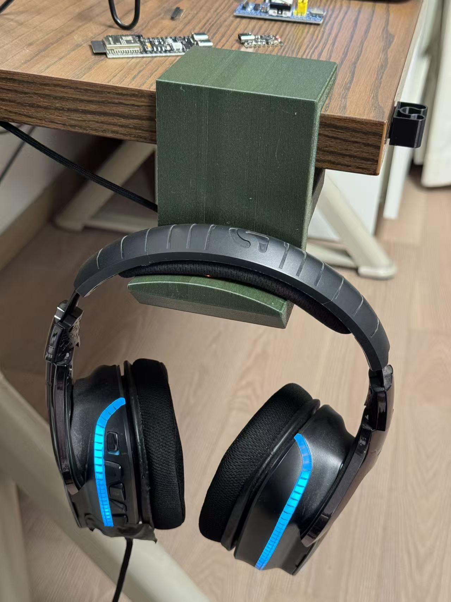
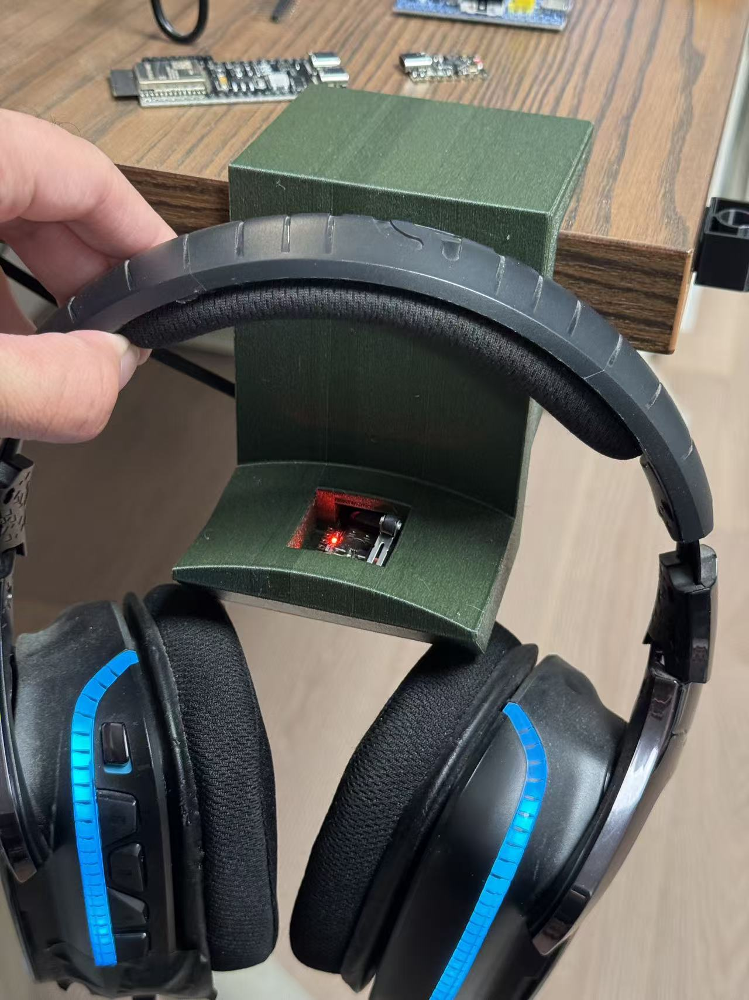

# 硬件文件（3D 打印支架）

> 拾音知音 · PickUp Audio 的参考支架结构。可自行打印或改进——欢迎贡献更好的设计。

## 文件清单

| 文件 | 说明 |
|---|---|
| `stand_body_v7.stl` | 支架主体（预留电路板仓和走线孔） |
| `thumbscrew_long_v4.stl` | 长款桌边固定手拧螺丝（适合较厚桌面） |
| `thumbscrew_short_v4.stl` | 短款桌边固定手拧螺丝（适合较薄桌面） |

## 组装

1. 打印三个零件（PLA 即可）
2. 将焊好微动开关的 ESP32-C3 SuperMini 放入支架主体的电路板仓
3. USB 线从走线孔引出
4. 用手拧螺丝将支架夹在桌边（根据桌面厚度选长或短）

## 实拍效果

| 耳机放下 | 耳机拿起 |
|---|---|
|  |  |

## 改进方向（欢迎贡献）

- **免焊版**：设计机械结构让耳机重量直接压到板上 BOOT 键（固件已支持双触发源）
  ⚠ 注意：C3 的 BOOT(GPIO9) 是 strapping 脚，上电时被压住会进下载模式——
  需确保插电瞬间 BOOT 不被压住，或改用非 strapping 引脚
- PCB 化：定制载板替代 SuperMini 直插
- 走线优化：USB 线出口位置、开关走线槽

## 许可

STL 文件与项目主体同为 MIT 许可——可自由打印、修改、再分发。
