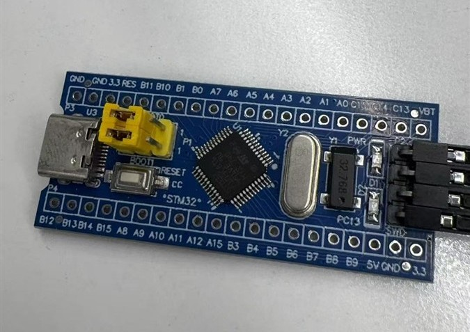
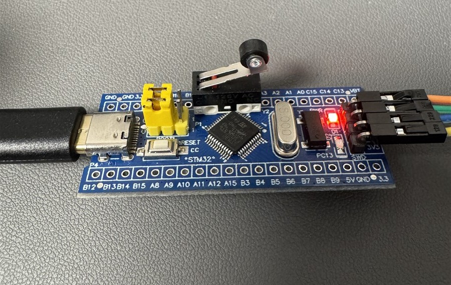
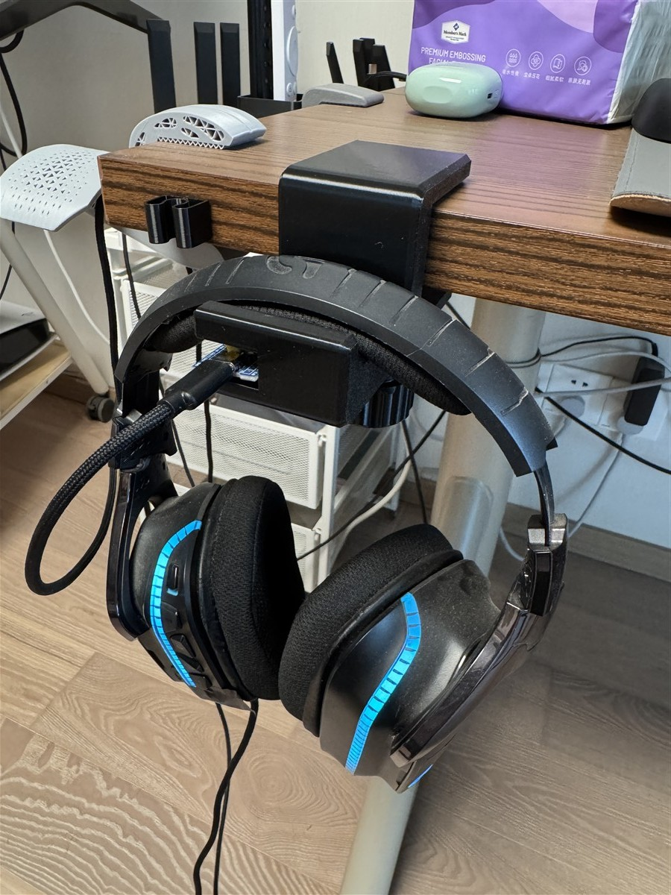
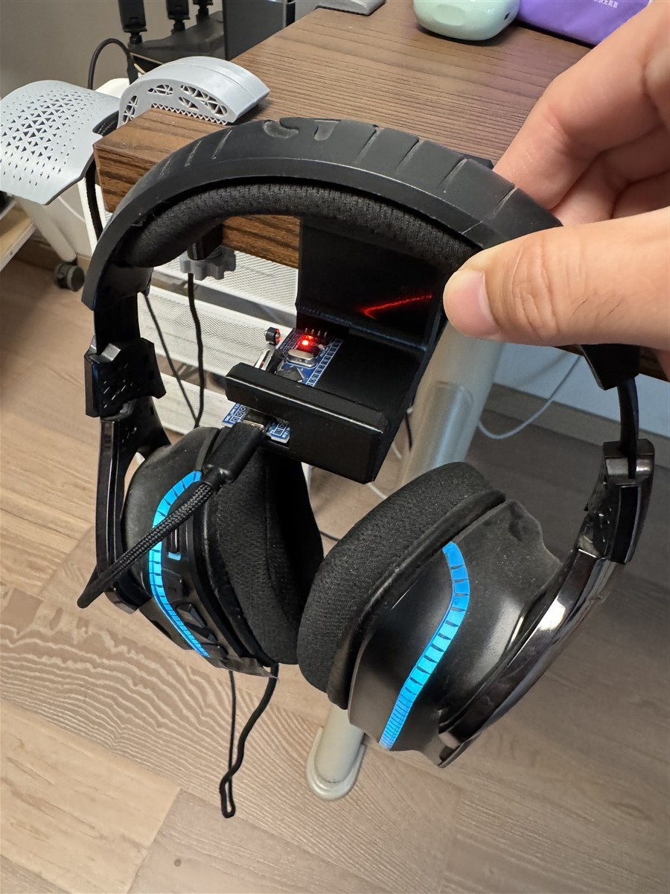

# STM32 旧版硬件（v1 归档）

> 这是 v1 时期的参考硬件，已被 [架上知音 · PickUp Audio（ESP32-C3 路线）](../README.zh-CN.md)取代。
> 上位机仍完全兼容（HID 传输），可与 C3 支架混插使用。此目录不再更新。

## 硬件

| 部件 | 说明 |
|---|---|
| STM32F103C8T6 "Blue Pill" 最小系统板 | 约 ¥10-15；自定义双向 HID（8 字节收/发） |
| 微动开关 | 鼠标键式微动（引脚直插板上排针孔直焊） |
| ST-Link V2 | 烧录用（淘宝约 ¥15；也可让卖板店家代烧 hex） |

接线（开关引脚直插板上排针孔，共 2 个焊点）：
- `PB0` ↔ 微动开关一脚（输入，内部上拉）
- `PA6` ↔ 微动开关另一脚（输出低电平，当 GND 用）

实拍（买板 → 焊开关 → 装架）：

| 板子 | 焊好开关 | 装进支架（放下 / 拿起） |
|---|---|---|
|  |  |   |

耳机放在架上压住开关（导通，低电平）= 在架上 = 放回；拿起耳机开关弹起（高电平）= 拿起。

## 烧录

需要 ST-Link + [STM32CubeProgrammer](https://www.st.com)（免费），
固件 hex 可从 [v0.16.1 Release](https://github.com/lhw-lab/PickUpAudio/releases/tag/v0.16.1) 下载，或从本目录源码自行编译。

```bash
STM32_Programmer_CLI -c port=SWD -w firmware_v0.16.1.hex -v -rst
```

完整步骤与排错见 [FLASHING-STM32.md](FLASHING-STM32.md)。
不熟悉烧录？把该文档发给任意 AI 助手，说"带我完成这件事"。

## 编译固件

需 STM32CubeIDE（或 headless 命令行）：

```bash
stm32cubeidec.exe --launcher.suppressErrors -nosplash \
  -application org.eclipse.cdt.managedbuilder.core.headlessbuild \
  -data <workspace目录> -import <stm32/firmware 绝对路径> -cleanBuild firmware
```

产物：`stm32/firmware/Debug/firmware.elf`（objcopy 转 hex 即可烧录）。

## 与 C3 的区别

| | STM32（本目录） | ESP32-C3（主线） |
|---|---|---|
| 焊接 | 2 个焊点 | 2 个焊点 |
| 烧录 | ST-Link + CubeProgrammer | 上位机一键，2 秒 |
| 价格 | 板 ¥10-15 + ST-Link ¥15 | 板 ¥7-10 |
| 传输 | USB HID | USB 串口(CDC) |
| 双触发源 | 无（只有外接开关） | 有（BOOT 键 + 外接开关仲裁） |
| 新功能 | 不再添加 | 持续开发 |

## 许可

内含 ST 库（SLA0044 / BSD-3 / Apache-2.0），见 [THIRD-PARTY-NOTICES.md](../THIRD-PARTY-NOTICES.md)。
原创代码与主项目同为 MIT。
